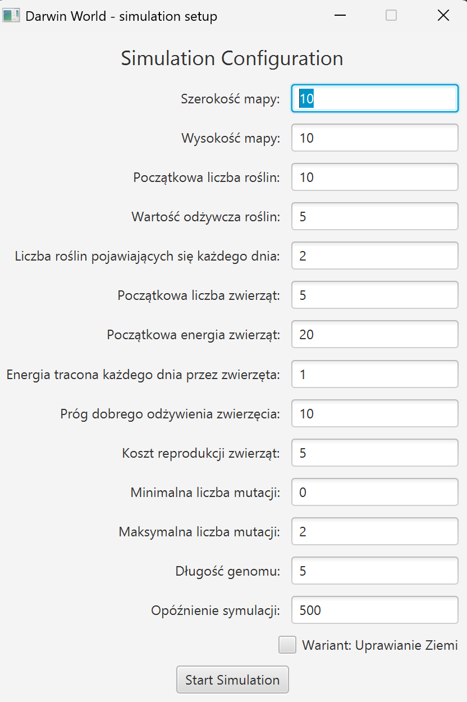
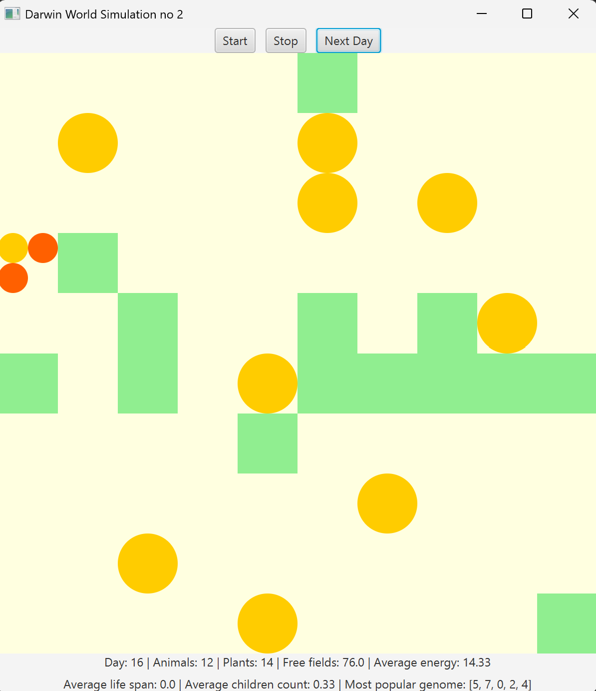

# Darwin World — Ecosystem Evolution Simulator


An interactive, multithreaded ecosystem evolution simulator built in Java and JavaFX. The application models Darwinian natural selection, genetic inheritance, and population dynamics on a 2D grid where autonomous agents move, forage, reproduce, and adapt to changing environmental constraints over time.

## Screenshots

|                               Configuration View                                |                         Live Simulation Dashboard                          |
| :-----------------------------------------------------------------------------: | :------------------------------------------------------------------------: |
|                                            |                            |
| _World parameters, energy rules, mutation settings, and map variant selection._ | _Real-time 2D grid rendering, population charts, and per-epoch telemetry._ |

## Key Features

- **Configurable Simulation Engine:** Customize world dimensions, initial plant and animal populations, energy thresholds, mutation bounds, simulation tick intervals, and map variants (_Globe_ or _Toxic Crops_) prior to execution.
- **Modular Map Topologies:**
  - `GlobeMap` — spherical-like grid with horizontal wrap-around (east-west continuity) and impassable polar boundaries at the north and south edges.
  - `VariantMap` (_Toxic Crops_) — extensible map variant introducing hazardous flora and alternative environmental growth mechanics.
- **Genetics & Evolutionary Mechanics:** Each animal carries an 8-gene behavioral array governing movement direction probabilities. Offspring inherit combined genomes from parents with configurable mutation counts and strategies.
- **Real-Time Canvas Rendering & Telemetry:** High-frequency JavaFX UI updates (`SimulationRenderer`) visualizing entity positions, energy levels, and plant distribution alongside live population/plant charts and simulation controls (Pause/Resume, Restart, dominant genotype tracking).
- **Live Statistics & CSV Export:** Tracks per-epoch ecosystem metrics (current day, animal/plant counts, unoccupied tiles, average energy, average lifespan, and average offspring count) with optional `.csv` export (`StatsFileManager`).

## Architecture & Engineering Highlights

This project was designed with clean Object-Oriented Programming principles and separation of concerns in mind:

- **Decoupled MVC / Observer Architecture:** The core simulation engine (`Simulation`, `SimulationEngine`) operates independently of the UI layer, notifying `MainController` and `SimulationRenderer` of state changes through the `SimulationChangeListener` interface.
- **Extensibility via Polymorphism:** Map behaviors share a common `WorldMap` interface and `AbstractWorldMap` base class, making it straightforward to introduce new map topologies without altering the simulation loop.
- **Automated Verification:** Core domain mechanics—including boundary wrapping, movement resolution, and simulation step invariants—are covered by JUnit 5 unit tests.

## Tech Stack

- **Core Language:** Java 17+
- **Desktop UI:** JavaFX, FXML
- **Build & Dependency Management:** Gradle (with Gradle Wrapper)
- **Testing:** JUnit 5

## Project Structure

```text
src/
├── main/
│   ├── java/org/darwin_world/
│   │   ├── Main.java                 # Application entry point
│   │   ├── MainGUI.java              # JavaFX stage & scene setup
│   │   ├── StartController.java      # Simulation configuration controller
│   │   ├── MainController.java       # Active simulation controls & live stats UI
│   │   ├── SimulationRenderer.java   # Real-time 2D grid & entity renderer
│   │   └── model/
│   │       ├── elements/             # Animal and Plant domain entities
│   │       ├── exceptions/           # Domain-specific exceptions
│   │       ├── map/                  # WorldMap interface, GlobeMap, VariantMap, Boundary
│   │       ├── simulation/           # SimulationEngine, GeneUtils, StatsManager, Listeners
│   │       └── util/                 # Vector2D, StatsFileManager (CSV), SimulationIdGenerator
│   └── resources/
│       ├── config.fxml               # Configuration view layout
│       └── main.fxml                 # Simulation dashboard layout
└── test/
    └── java/org/darwin_world/        # JUnit 5 test suites for maps and simulation logic
```

## Getting Started

### Run Locally

1. Clone the repository:

   ```bash
   git clone https://github.com/fistaszek017/darwinworld.git
   cd darwinworld
   ```

2. Launch the application using the Gradle Wrapper:
   - **Linux / macOS:**
     ```bash
     ./gradlew run
     ```
   - **Windows:**
     ```bash
     gradlew.bat run
     ```

### Run Unit Tests

```bash
./gradlew test
```
